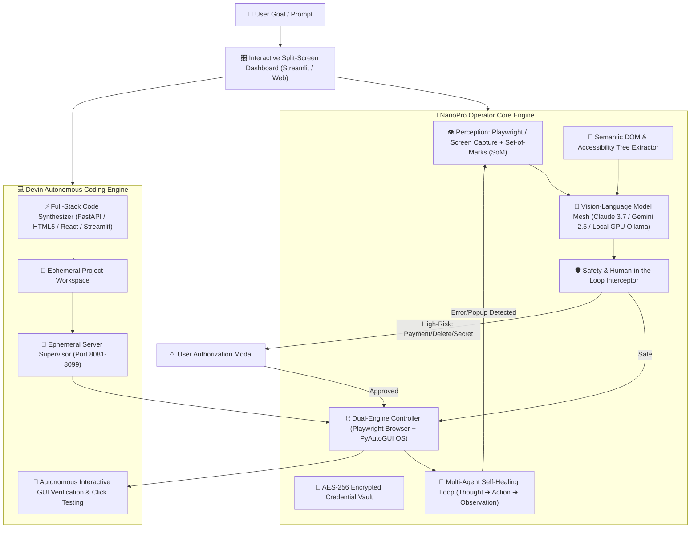

# 🧠 NanoPro Operator — Autonomous GUI Computer-Use AI Agent & Devin Engine

Production-ready, enterprise-grade **Autonomous GUI Computer-Use AI Agent** and **Devin-style Full-Stack Web Development Engine** built with Python, Playwright, PyAutoGUI, Set-of-Marks visual grounding, and Multi-Modal Vision LLMs (supporting 4,804+ models via OpenRouter/Defapi, Claude 3.7 Sonnet, Gemini 2.5 Pro/Flash, and local GPU-accelerated Ollama).

---

## 🏗️ System Architecture



---

## 📁 Complete Folder Structure

```
nanopro_operator/
├── __init__.py                       # Package initialization & versioning
├── config.py                         # Production configuration, model catalog, viewport, safety rules
├── requirements.txt                  # Production dependencies
├── run_operator.py                   # Unified CLI runner (Web UI, CLI agent, Devin engine)
├── start_operator.bat                # 1-Click Windows execution script
├── README.md                         # Architecture & GPU setup guide
├── core/
│   ├── __init__.py
│   ├── som_visual_marker.py          # Set-of-Marks (SoM) high-contrast visual badge annotator
│   ├── dom_tree_parser.py            # Accessibility & interactive DOM element extractor
│   ├── credential_vault.py           # AES-256-GCM encrypted credentials vault
│   ├── safety_guardrails.py          # Human-in-the-loop safety & risk assessment interceptor
│   ├── controller.py                 # Dual-mode controller (Playwright + PyAutoGUI, Bézier mouse gliding)
│   ├── vision_agent.py               # Multimodal VLM router (OpenRouter, Gemini, Claude, Ollama)
│   └── self_healing_engine.py        # Self-healing reasoning loop (Thought -> Action -> Observation)
├── devin_engine/
│   ├── __init__.py
│   ├── workspace_manager.py          # Ephemeral project filesystem manager
│   ├── test_runner.py                # Ephemeral local server supervisor & port allocator
│   ├── code_generator.py             # Full-stack code synthesizer (FastAPI + HTML5/Tailwind/Charts)
│   └── autonomous_dev_loop.py        # Devin cycle: Code -> Run Server -> CUA Navigate -> GUI Test -> Self-Heal
└── ui/
    ├── __init__.py
    └── app.py                        # Split-Screen Streamlit Dashboard (Left: Cockpit, Right: Live Stream)
```

---

## ⚡ Core Capabilities

### 1. Vision-Language GUI Control & Natural Human Mouse/Keyboard
- **Set-of-Marks (SoM) Grounding:** Annotates interactive screen elements with numbered badges `[0]`, `[1]`, `[2]`, eliminating coordinate drift and ensuring 100% precision.
- **Human-like Bézier Mouse Motion:** Moves the cursor along natural quadratic curves with realistic acceleration, settle delays, and visual laser ripple clicks.
- **Dual Engine:** Seamlessly switches between in-browser Playwright automation and OS-level PyAutoGUI for native windows and file pickers.

### 2. Autonomous Reasoning & Self-Healing Error Recovery
- Runs continuous **Thought ➔ Action ➔ Observation** cycles.
- If a form field is covered, an unexpected modal or cookie banner pops up, or a network request fails, the **Critic Agent** detects the error, dismisses the blocker, adapts its strategy, and retries without crashing.

### 3. Devin Autonomous Full-Stack Web Development
- Automatically plans, codes, and structures complete web applications (FastAPI backend + HTML5/CSS/JavaScript/Streamlit frontend).
- Spins up local ephemeral servers (`http://127.0.0.1:8085`).
- Points Playwright to the live server, autonomously fills out the newly created forms, clicks buttons, verifies charts, checks console logs, and self-heals code if bugs appear.

### 4. Interactive Split-Screen Dashboard UI
- **Left Panel:** Chat cockpit, real-time Thought-Action timeline, model selector, credential vault, safety authorization modals.
- **Right Panel:** Live browser viewport stream with Set-of-Marks badges, laser cursor indicator, and live interactive web preview.

### 5. Safety & Human-in-the-Loop Guardrails
- Automatically intercepts high-risk operations (financial transactions, payouts, permanent deletions, database drops, and root credential submissions).
- Pauses execution and prompts the user with an interactive **Authorize / Deny** checkpoint.

---

## 🚀 Setup Instructions for Local Windows with GPU Acceleration

### Prerequisites
- **OS:** Windows 10 or 11 (64-bit)
- **Python:** 3.10, 3.11, or 3.12 (64-bit)
- **NVIDIA GPU:** RTX 3060, 3070, 3080, 4060, 4070, 4080, 4090 (or similar with >= 8GB VRAM)

### Step 1: Install Python Dependencies
Open PowerShell or Command Prompt in the repository root:
```powershell
pip install -r nanopro_operator/requirements.txt
playwright install chromium
```

### Step 2: GPU Acceleration via Ollama (For Local Offline Vision)
1. Download and install Ollama for Windows from [ollama.com](https://ollama.com/download/windows).
2. Verify NVIDIA CUDA GPU acceleration:
   ```powershell
   ollama --version
   nvidia-smi
   ```
3. Pull high-performance multimodal vision models onto your GPU:
   ```powershell
   # High-accuracy multimodal vision model (fits in 8GB-12GB VRAM):
   ollama pull qwen2.5vl:latest
   
   # Or LLaVA:
   ollama pull llava:latest
   ```
4. Ollama automatically leverages your NVIDIA GPU via CUDA. NanoPro Operator connects to `http://localhost:11434` with zero configuration needed.

### Step 3: Cloud Vision Frontier Models Setup (Optional)
Set environment variables for cloud frontier models (OpenRouter, Gemini, Claude):
```powershell
# OpenRouter / Defapi Multi-Model Mesh (4,804+ models):
$env:OPENROUTER_API_KEY="your_openrouter_or_defapi_key"

# Or Google Gemini Direct:
$env:GEMINI_API_KEY="your_gemini_api_key"

# Or Anthropic Claude Direct:
$env:ANTHROPIC_API_KEY="your_anthropic_api_key"
```

---

## 💻 How to Run

### Option A: Launch Interactive Split-Screen Dashboard (Recommended)
Double-click `nanopro_operator\start_operator.bat` or run:
```powershell
python nanopro_operator/run_operator.py --ui
```
Opens in your browser at `http://localhost:8501`.

### Option B: Run Autonomous CUA GUI Agent via CLI (Headed Visible Window)
```powershell
python nanopro_operator/run_operator.py --task "Search Google for top AI conferences in 2026, click the first link, and extract dates" --headed
```

### Option C: Run Devin Autonomous Full-Stack Web Development Engine
```powershell
python nanopro_operator/run_operator.py --devin "Build a modern Banking Fixed Deposit Calculator with compound interest projection chart and customer KYC form"
```
Devin will write the code, launch the server, open Chromium, test the interactive calculator, click the submit button, and report the live URL!
